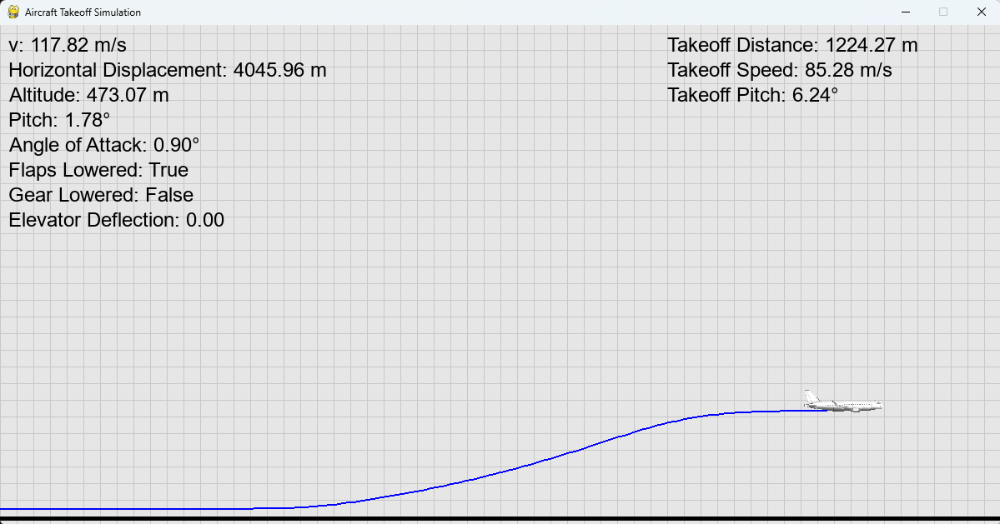
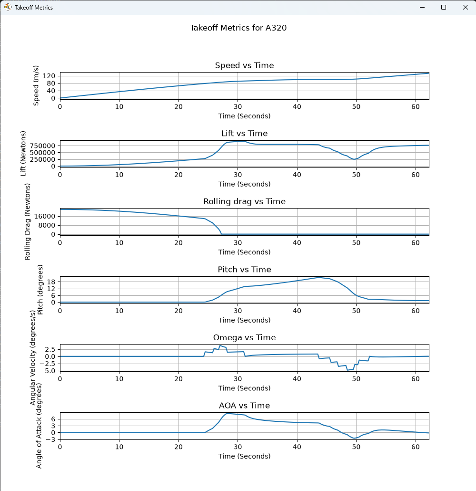

## Aircraft Takeoff Simulation

A 2D simulation for simulating flight dynamics of an aircraft during takeoff. Includes a graphical representation of the simulation and a graphical summary of critical flight variables throughout the simulation.

## Demo


## Features
### Physics Engine
This simulation uses a simplified 2D physics model. At the core of this physics model are 5 state variables. These variables represent position and velocity in horizontal and vertical axes, as well as the pitch angle of the aircraft. These state variables are integrated using the DOP853 numerical solver.

In addition to the state variables are several derived variables. These variables represent dynamic forces acting on the aircraft. Examples of these variables include lift, drag, and angle of attack. These variables are all calculated and determine the flight behaviour in real-time. Many of these variables have strong interconnectedness, like angle of attack with drag and lift coefficients. User input is interpreted through elevator inputs as well as landing gear and flap controls. Elevator inputs control the elevator deflection, which in turn affects the pitch of the aircraft. The effectiveness of the aircraft's elevators will strongly vary, depending on airspeed. The landing gear and flaps will change the lift and drag coefficients of the aircraft as they are deployed and retracted.

### Other Features
Graphical representation of simulation

Select from several aircraft types:
- Airbus A320
- Boeing 777
- Airbus A318
- Cessna Citation CJ4
- F16

Interactive key controls:
- 'w' to pitch up
- 's' to pitch down
- 'f' to toggle flaps
- 'g' to raise landing gear
- 'Esc' to end simulation

Charts displaying evolution of critical variables throughout takeoff:



## Tech Stack
- Python
- Scipy-integrate - numerical integration of simulation variables
- Pygame CE - Simulation graphics and controls
- Numpy - Array operations
- Matplotlib - Data visualization

## Setup Instructions
### Requirements
- Python 3.14.6
- Git

### Installation
Clone the repository: 
```a```

Open terminal from the root of the project and install dependencies:
```pip install -r requirements.txt```

### Running the Simulation
Run the simulation:
```python -m takeoffsimulation```

